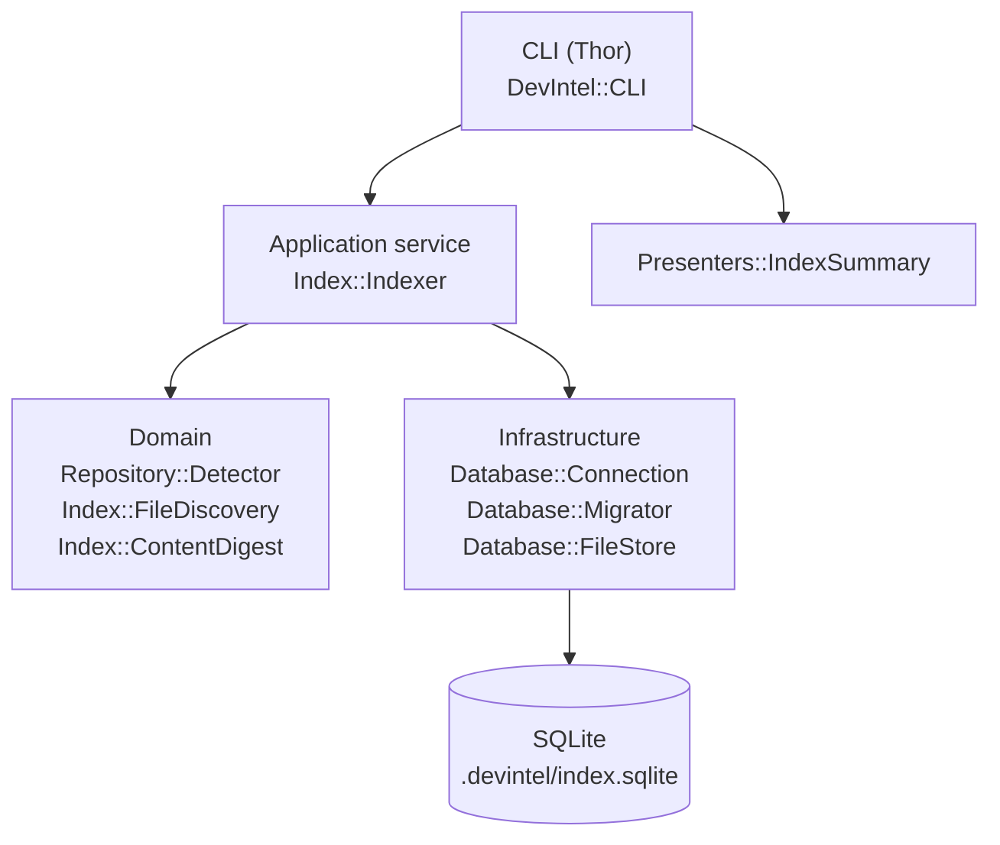
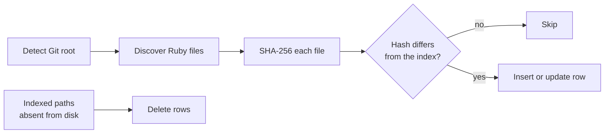

# DevIntel

Local-first developer intelligence for Ruby codebases.

DevIntel builds a deterministic index of a repository — files, and later symbols,
references and their relationships — and uses it to answer questions about
structure, change impact and review risk.

The ordering principle is deliberate:

```
Evidence → Code Intelligence → Impact Analysis → AI assistance
```

DevIntel analyses source code **statically**. It never requires, boots or
connects to the application under analysis, so DevIntel's Ruby version is
independent of the target project's Ruby version — DevIntel on Ruby 3.3 can
index an application on Ruby 3.1 / Rails 7.0.

## Status

Milestone 0 (bootstrap) and the first slice of Milestone 1 (repository + file
index) are implemented. `devintel index` discovers and fingerprints Ruby files;
symbol extraction, the graph, impact analysis and review are not implemented yet.

## Requirements

- Ruby >= 3.3
- A Git repository to analyse

## Installation

```sh
git clone <this repository>
cd devintel
bundle install
```

Run it from a checkout with `bundle exec devintel`, or add `bin/` to your PATH.

## Quick start

```sh
cd /path/to/your/app
devintel index
```

```
DevIntel Index

Repository:
  /path/to/your/app

Ruby files:
  842

Changed:
  842  (new 842, modified 0, removed 0)

Indexed:
  842

Database:
  .devintel/index.sqlite

Duration:
  1.12s
```

Running it again re-reads only what changed:

```
Changed:
  3  (new 1, modified 2, removed 0)

Indexed:
  3
```

## Commands

| Command | Status | Description |
| --- | --- | --- |
| `devintel --version` | available | Print the DevIntel version |
| `devintel index` | available | Build or update the local index |
| `devintel map` | planned | Local web UI for the knowledge map |
| `devintel search <query>` | planned | Search symbols and relationships |
| `devintel trace <symbol>` | planned | Callers, callees and tests for a symbol |
| `devintel impact` | planned | Impact of a change against a base ref |
| `devintel review` | planned | Deterministic review findings for a diff |
| `devintel doctor` | planned | Diagnose the local index |

### `devintel index`

| Option | Default | Description |
| --- | --- | --- |
| `--path PATH` | `.` | Directory inside the repository to start from |
| `--force` | `false` | Re-index every file, ignoring unchanged content hashes |

## Architecture

Four layers, with dependencies pointing downwards only. The CLI contains no
analysis logic.



An indexing run:



## Local data

```
.devintel/
  index.sqlite     # the local index
  .gitignore       # generated; keeps the index out of your history
```

The index is a derived artefact: disposable and reproducible by re-running
`devintel index`. Delete `.devintel/` at any time. DevIntel writes nothing
outside `.devintel/`.

Schema (v1):

| Table | Purpose |
| --- | --- |
| `files` | path, language, content hash, size, updated_at |
| `metadata` | provenance: DevIntel version, schema version, digest algorithm, last run |
| `schema_migrations` | applied schema versions |

The schema moves forward through numbered migrations; the database is never
dropped and recreated during normal indexing, because incremental indexing
depends on the previous run's hashes surviving.

## Privacy

DevIntel is local-first and offline. It makes no network requests, sends no
telemetry, and transmits no source code, Git history or file paths anywhere. No
LLM is involved. If an external model provider is ever supported it will be an
explicit, configurable opt-in.

## Limitations

- Ruby only.
- File-level index only: no symbols, references, graph, impact or review yet.
- Discovery is by extension (`.rb`, `.rake`, `.gemspec`, `.ru`), by well-known
  filename (`Rakefile`, `Gemfile`, `Guardfile`, `Capfile`), and by Ruby shebang
  for extensionless executables such as `bin/console`.
- `.git`, `.devintel`, `node_modules`, `tmp`, `log` and `vendor` are skipped at
  any depth. `.gitignore` is not consulted yet.
- Symlinks are not followed.

## Development

```sh
bundle install
bundle exec rspec     # tests
bundle exec rubocop   # lint
bundle exec rake      # both via the default task
```

Tests are fixture-first: each example builds a small throwaway repository on
disk and asserts on precise behaviour rather than on snapshots.

## License

MIT. See [LICENSE](LICENSE).
