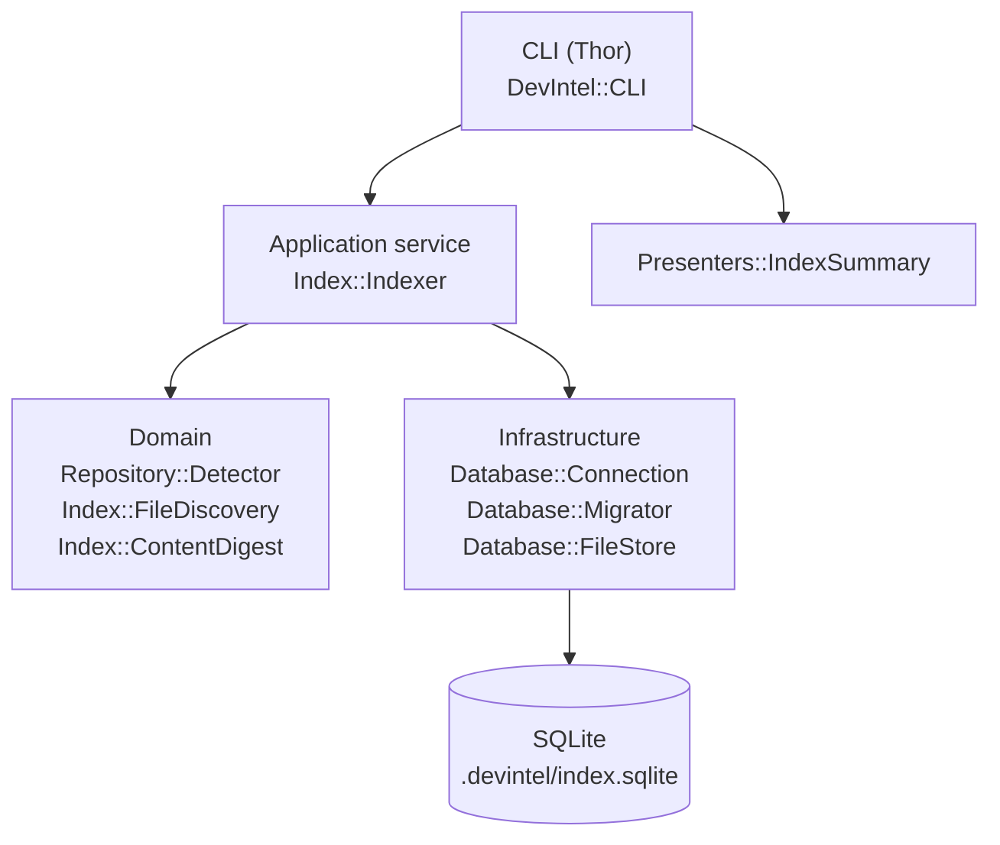
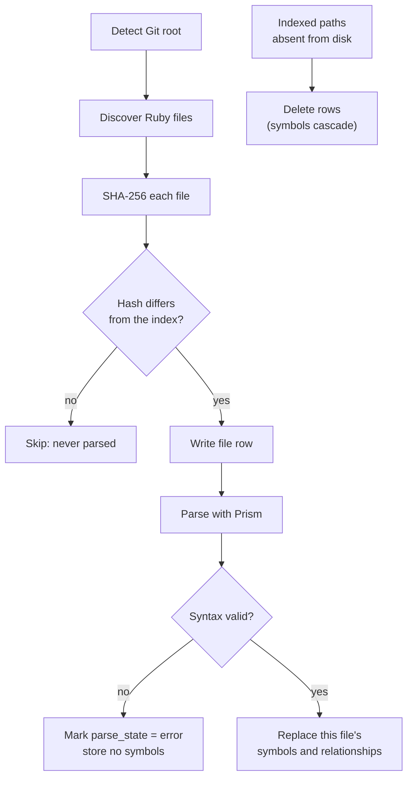
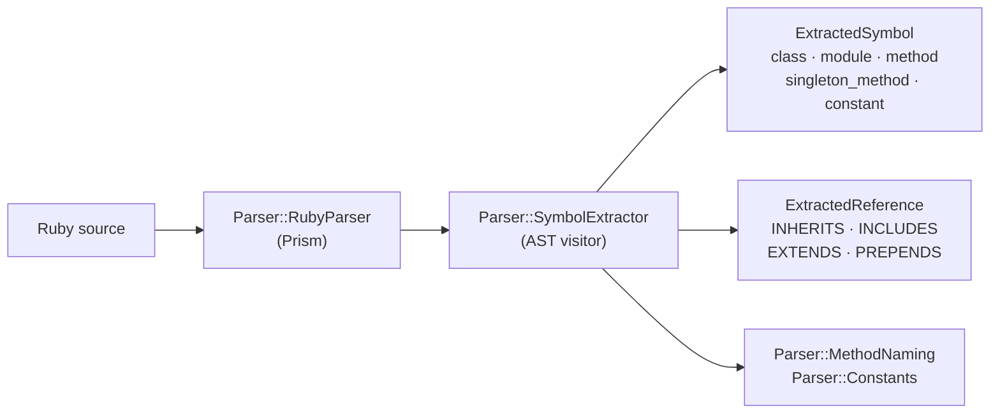

# DevIntel

Local-first developer intelligence for Ruby codebases.

DevIntel builds a deterministic index of a repository — files, and later symbols,
references and their relationships — and uses it to answer questions about
structure, change impact and review risk.

The ordering principle is deliberate:

```
Evidence → Code Intelligence → Impact Analysis → AI assistance
```

DevIntel analyses source code **statically**. It never requires, boots or
connects to the application under analysis, so DevIntel's Ruby version is
independent of the target project's Ruby version — DevIntel on Ruby 3.3 can
index an application on Ruby 3.1 / Rails 7.0.

## Status

Milestones 0-3 are implemented: `devintel index` builds the symbol graph —
classes, modules, methods, constants, inheritance, mixins, calls and constant
references — and `devintel trace` answers what reaches a symbol and what it
reaches. Impact analysis, review and the web UI are not implemented yet.

## Requirements

- Ruby >= 3.3
- A Git repository to analyse

## Installation

```sh
git clone <this repository>
cd devintel
bundle install
```

Run it from a checkout with `bundle exec devintel`, or add `bin/` to your PATH.

## Quick start

```sh
cd /path/to/your/app
devintel index
```

```
DevIntel Index

  Repository  /path/to/your/app
  Database    .devintel/index.sqlite

This run took 1.12s
  842  Ruby files  found on disk
  842  parsed      842 added, 0 modified
    0  skipped     unchanged since the last run
    0  removed     no longer on disk

Index now holds
  5120  symbols          method 3100, class 980, constant 620, module 420
   318  relationships    INHERITS 190, INCLUDES 110, EXTENDS 18
    12  dynamic targets  target cannot be named statically
     1  unparsed file    syntax error, so no symbols were stored
      app/legacy/report.rb
```

The summary answers two different questions, so it is split in two:

- **This run** — what the indexer just did. Every discovered file is either
  parsed or skipped; `removed` are files that have left the repository.
- **Index now holds** — what the database contains afterwards. These totals
  describe the whole index, not this run, so they stay the same when a run has
  nothing to do.

Running it again re-reads only what changed, and the split makes that obvious:

```
This run took 0.21s
  842  Ruby files  found on disk
    3  parsed      1 added, 2 modified
  839  skipped     unchanged since the last run
    0  removed     no longer on disk

Index now holds
  5120  symbols          method 3100, class 980, constant 620, module 420
  ...
```

## Commands

| Command | Status | Description |
| --- | --- | --- |
| `devintel --version` | available | Print the DevIntel version |
| `devintel index` | available | Build or update the local index |
| `devintel map` | planned | Local web UI for the knowledge map |
| `devintel search <query>` | planned | Search symbols and relationships |
| `devintel trace <symbol>` | available | Callers, callees and tests for a symbol |
| `devintel impact` | planned | Impact of a change against a base ref |
| `devintel review` | planned | Deterministic review findings for a diff |
| `devintel doctor` | planned | Diagnose the local index |

### `devintel trace`

```sh
devintel trace OrderService      # or a simple name: devintel trace Invoice
```

```
OrderService

  class  app/services/order_service.rb:3-11

Callers  reach this symbol
  (file scope)             REFERENCES  FACT                 spec/services/order_service_spec.rb:3
  (file scope)             CALLS       INFERENCE  #execute  spec/services/order_service_spec.rb:5
  CheckoutService#execute  CALLS       FACT       .new      app/services/checkout_service.rb:5
  CheckoutService#execute  CALLS       INFERENCE  #execute  app/services/checkout_service.rb:5

Callees  this symbol reaches
  OrderRepository.save   CALLS  FACT       app/services/order_service.rb:6
  PaymentService#charge  CALLS  INFERENCE  app/services/order_service.rb:5
  + 1 relationship DevIntel could not follow  (unknown receiver 1)

Tests  files that name this symbol
  spec/services/order_service_spec.rb
```

Test files are found by what they reference, not by their filename: a spec
earns the link by naming the symbol.

### `devintel index`

| Option | Default | Description |
| --- | --- | --- |
| `--path PATH` | `.` | Directory inside the repository to start from |
| `--force` | `false` | Re-index every file, ignoring unchanged content hashes |

## Architecture

Four layers, with dependencies pointing downwards only. The CLI contains no
analysis logic.



An indexing run:



The parser layer:



## Local data

```
.devintel/
  index.sqlite     # the local index
  .gitignore       # generated; keeps the index out of your history
```

The index is a derived artefact: disposable and reproducible by re-running
`devintel index`. Delete `.devintel/` at any time. DevIntel writes nothing
outside `.devintel/`.

Schema (v2):

| Table | Purpose |
| --- | --- |
| `files` | path, language, content hash, size, updated_at, parse_state |
| `symbols` | type, name, qualified_name, line_start, line_end, file |
| `symbol_references` | graph edges: INHERITS, INCLUDES, EXTENDS, PREPENDS, CALLS, REFERENCES |
| `metadata` | provenance: DevIntel version, schema version, digest algorithm, last run |
| `schema_migrations` | applied schema versions |

`symbol_references` is spelled out rather than `references` because REFERENCES
is a reserved word in SQLite.

Applying a migration forces a full re-analysis on the next run: file hashes
survive migrations, so otherwise every file would look unchanged and the new
tables would stay empty.

The schema moves forward through numbered migrations; the database is never
dropped and recreated during normal indexing, because incremental indexing
depends on the previous run's hashes surviving.

## Privacy

DevIntel is local-first and offline. It makes no network requests, sends no
telemetry, and transmits no source code, Git history or file paths anywhere. No
LLM is involved. If an external model provider is ever supported it will be an
explicit, configurable opt-in.

## Evidence model

Every edge in the graph records how far DevIntel actually got, so an inference
can never be read as an observation:

| resolution | meaning | evidence |
| --- | --- | --- |
| `resolved` | points at a definition in this repository | FACT |
| `named` | the target is named but defined elsewhere (a gem, Rails, Kernel) | FACT |
| `receiver_only` | the receiver is one of your classes, but it does not define the method called (`FileStore.new`) | FACT |
| `inferred` | the receiver's type was inferred: `Foo.new.bar` → `Foo#bar` | INFERENCE |
| `unknown_receiver` | the method name is known, what it was called on is not (`order.total`) | UNKNOWN |
| `dynamic` | nothing determinable: `object.send(method_name)`, `class X < Struct.new(:a)` | UNKNOWN |

```ruby
class Legacy < Struct.new(:a)   # INHERITS  dynamic
  include build_module          # INCLUDES  dynamic
end
```

Constant resolution follows Ruby's lexical rule — inside `module A; class B`,
the name `C` is searched for as `A::B::C`, then `A::C`, then `C` — and nothing
more. Ancestors are not searched, so a constant inherited from a superclass
resolves to nothing rather than to a guess.

A file whose syntax Prism rejects contributes **no** symbols at all — a partial
tree would mean inventing definitions the author never wrote — and is marked
`parse_state = 'error'` so the gap is visible rather than looking like an empty
file.

Definitions created at runtime (`define_method`, `send`, `class_eval`, Rails
macros such as `belongs_to`) are deliberately not extracted. A fabricated symbol
is worse than a missing one, because symbols are cited as evidence.

### What is deliberately not recorded

Ruby makes almost everything a method call. These are filtered out because they
are syntax, not relationships: operators (`a + b`, `x[0]`, `a == b`), attribute
assignment (`x.name = 1`), and calls on literals (`"text".upcase`, `[].map`).

A receiverless call that resolves to nothing in its own scope is dropped rather
than stored. `puts`, `expect`, `it`, a Rails macro, an `attr_accessor` and a
local variable are indistinguishable at this level, and recording them would
bury the graph — on DevIntel's own source they were 41% of all edges. The count
is reported by `devintel index` so the omission stays visible:

```
  1006  self-calls dropped  receiverless call not defined in its own scope
```

## Limitations

- Ruby only.
- No impact analysis or review yet, and no web UI.
- A method defined inside a block that changes the definee (`Data.define do ...
  end`, `Class.new do ... end`, `instance_eval`) is attributed to the enclosing
  class, which is where a block's `def` normally lands but not where these put
  it.
- Reopened classes are recorded once per definition rather than merged.
- A call to an **inherited or mixed-in** method does not resolve: resolution
  looks in the receiver's own class only, not along its ancestors. Walking
  INHERITS and INCLUDES edges during resolution is the obvious next improvement.
- Resolution re-runs over every edge on each indexing run. It is fast enough at
  this scale, but it is not incremental the way file parsing is.
- Discovery is by extension (`.rb`, `.rake`, `.gemspec`, `.ru`), by well-known
  filename (`Rakefile`, `Gemfile`, `Guardfile`, `Capfile`), and by Ruby shebang
  for extensionless executables such as `bin/console`.
- `.git`, `.devintel`, `node_modules`, `tmp`, `log` and `vendor` are skipped at
  any depth. `.gitignore` is not consulted yet.
- Symlinks are not followed.

## Development

```sh
bundle install
bundle exec rspec     # tests
bundle exec rubocop   # lint
bundle exec rake      # both via the default task
```

Tests are fixture-first: each example builds a small throwaway repository on
disk and asserts on precise behaviour rather than on snapshots.

## License

MIT. See [LICENSE](LICENSE).
